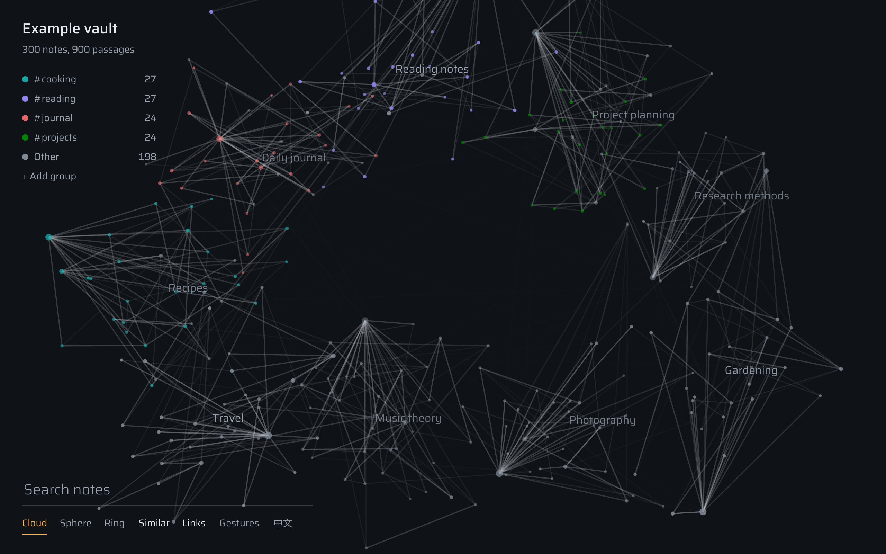

# Notes Graph 3D



Explore your Obsidian notes as a 3D graph of dots and lines. Notes that mean similar things sit close together, whether or not you have linked them. You can steer it with the mouse or, optionally, with your hands through a webcam.

The graph opens in your default browser, because Obsidian cannot access the camera on macOS.

## Requirements

- Obsidian desktop. Tested on macOS with Obsidian 1.15. Windows is expected to work but has not been tested yet.
- A recent Obsidian installer, not only a recent app version, because the plugin relies on the SQLite module built into newer installers
- The Analogy plugin, with your vault indexed. Notes Graph 3D reuses Analogy's embeddings and does not compute its own.

## Use

Click the orbit icon in the ribbon, or run **Open 3D graph in browser** from the command palette. The graph rebuilds when Analogy's index has changed. To force a rebuild, run **Rebuild 3D graph**.

| Action | Mouse and keyboard |
|---|---|
| Rotate, zoom | Drag, scroll |
| Select a note | Click a dot, or search and press Enter |
| Search | `/` |
| Switch layout | `1` cloud, `2` globe, `3` ring |
| Exit | `Esc` |
| Toggle gestures | `G` |
| Highlight a colour group | Click it in the legend |

| Gesture | Action |
|---|---|
| Make a fist with your left hand, point with your right index finger and hold still | Open the nearest note after 3 seconds, or press a button after 1 second. The graph stays still while a hand is in view. |
| Make a fist, then spread all five fingers | Exit the selection |
| Pinch and drag | Rotate |
| Pinch with both hands, then move them apart or together | Zoom |

Dots are sized by how many notes they link with and coloured by the legend. Use **+ Add group** to add any folder or tag, up to 8 groups. The legend is saved with the plugin's data for each vault.

The interface is in English or Traditional Chinese. The graph page follows your browser's language and has a switch next to the other controls; commands and notices follow Obsidian's language.

## Privacy and network use

- **Your notes stay on your computer.** The plugin runs a server on `127.0.0.1` only, behind a secret in the URL.
- **Camera video stays in your browser.** It is processed locally and never uploaded or stored.
- **One optional download.** The first time you turn on gestures, the page offers to download about 23 MB of hand-tracking files from `cdn.jsdelivr.net` and `storage.googleapis.com`. Nothing is downloaded unless you accept. Each file is verified against a checksum.
- **No telemetry.**
- **Files outside the vault.** The plugin reads Analogy's local index, and stores its graph cache and the hand-tracking files in `Notes Graph 3D` under your application data folder.

## Development

Needs Node 24 and pnpm.

```sh
pnpm install
pnpm data     # writes public/data/graph.json from your Analogy index
pnpm dev      # the page alone, at http://127.0.0.1:5173
pnpm plugin   # builds dist/plugin
node scripts/build_plugin.mjs --install /path/to/vault
```

`public/data/graph.json` contains titles and excerpts from your notes. It is git-ignored; do not publish it.

Everything that depends on Analogy's private database format lives in `obsidian-plugin/src/analogy.ts`.
